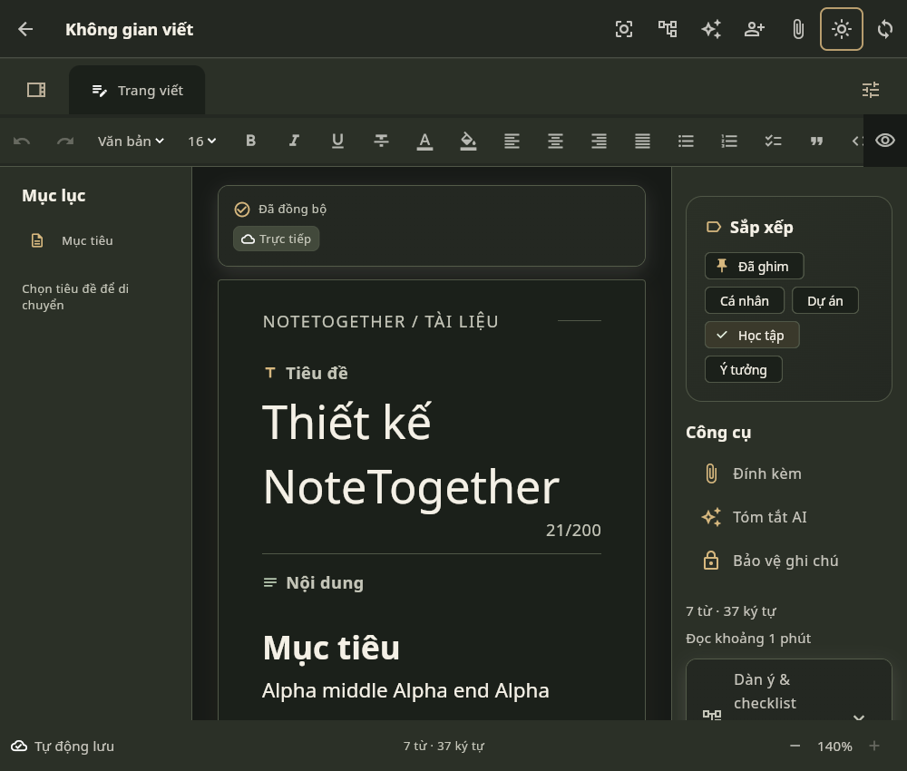
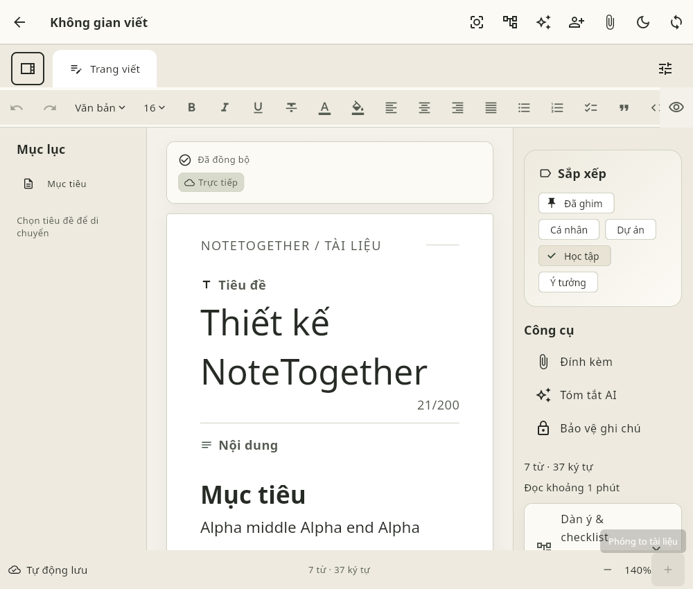
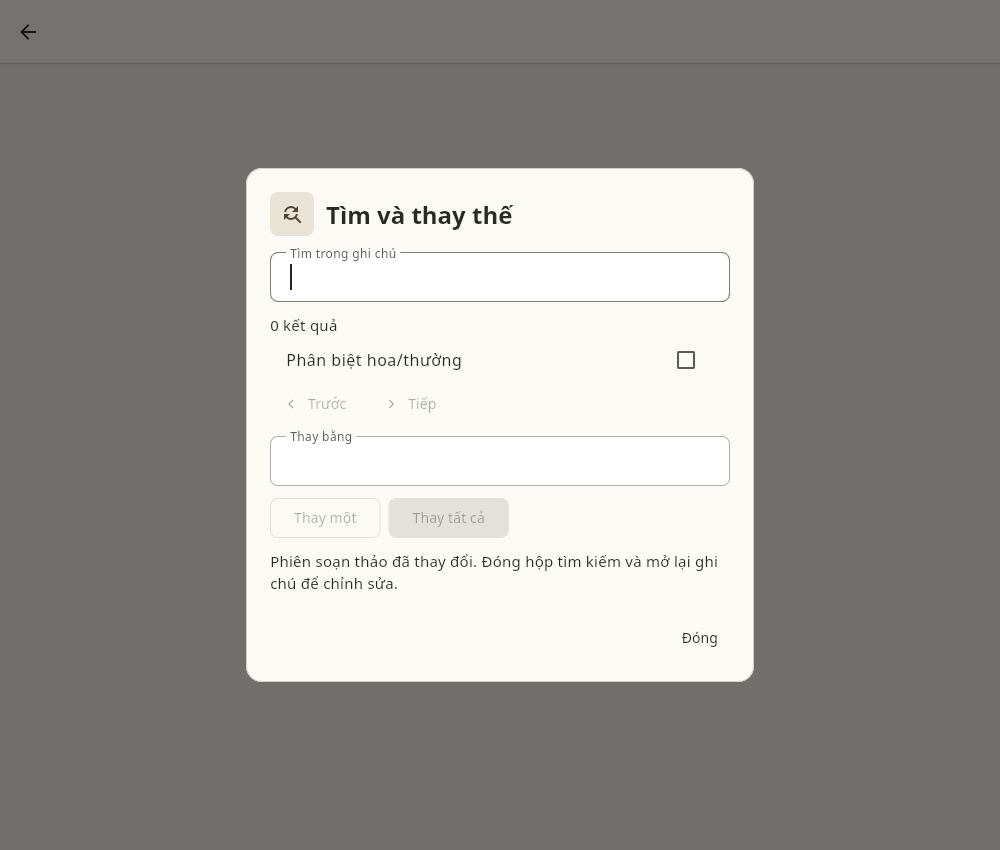
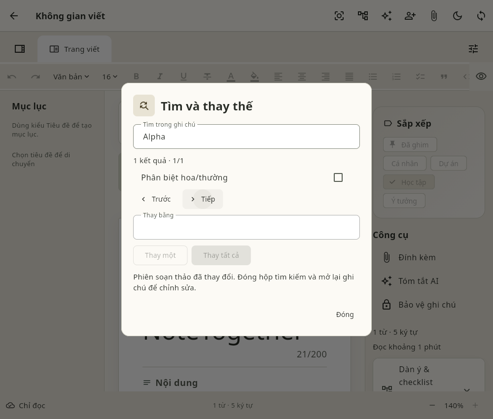
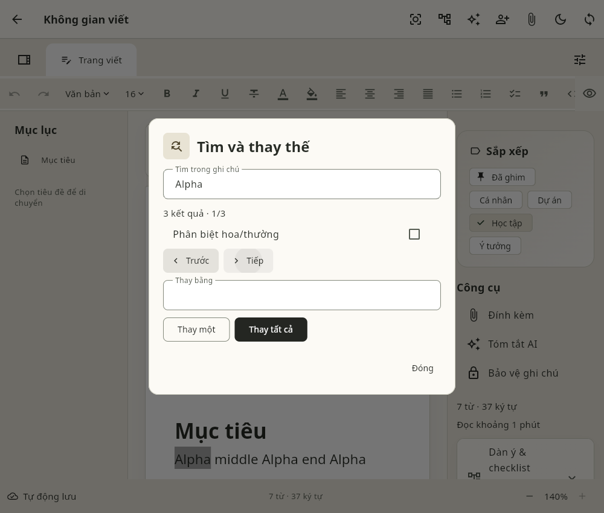
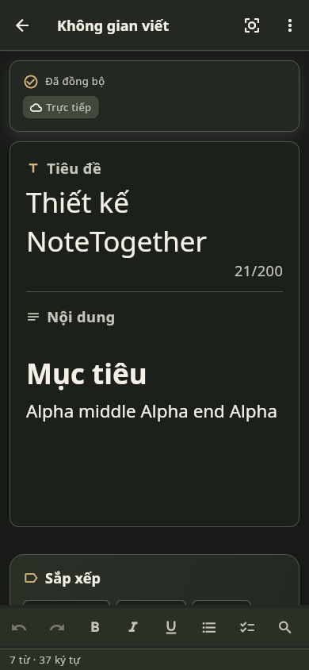
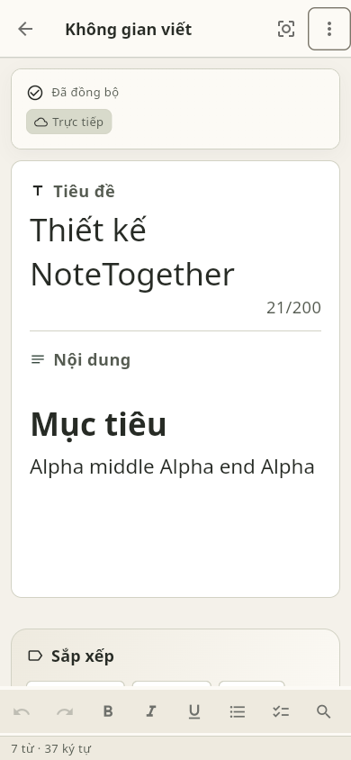

# Ảnh QA bug audit —12/10/2026

Chrome thật với dữ liệu tổng hợp. Ảnh phone là Web viewport; không phải native runtime.

[Phạm vi](INDEX.md)

## bug-audit-desktop-dark

## bug-audit-desktop-light

## bug-audit-find-hidden

## bug-audit-find-remote

## bug-audit-find-three

## bug-audit-phone-dark

## bug-audit-phone-light

## private-dom-before

